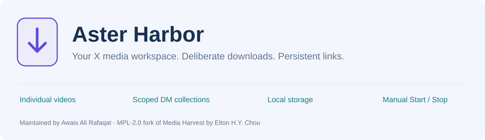
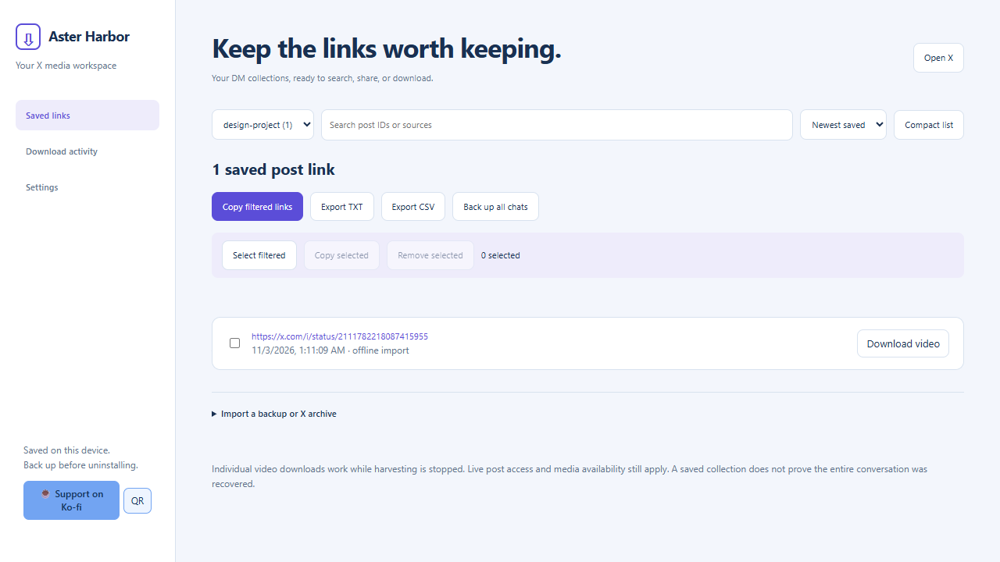
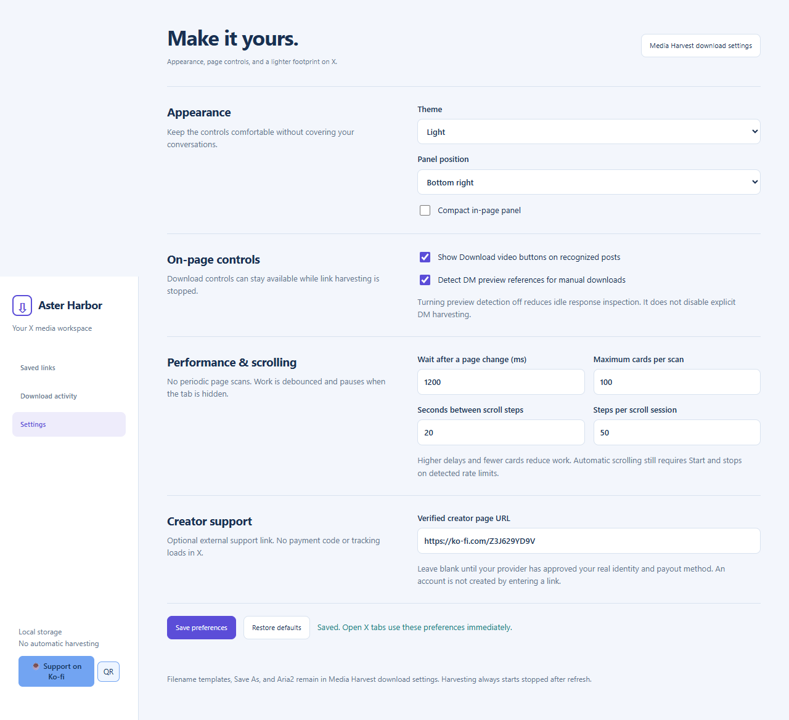

# Aster Harbor
## X Media Harvester & Persistent DM Link Workspace

**Maintained by Awais Ali Rafaqat** · [GitHub: owrew](https://github.com/owrew) · [Support on Ko-fi](https://ko-fi.com/Z3J629YD9V)

[Features](#what-it-does) · [Install](#install-locally) · [Build](#build-from-source) · [Architecture](#architecture-at-a-glance) · [Storage](#database-and-storage) · [Verification](#verification-and-its-limits) · [Store publishing](#chrome-web-store--edge-add-ons) · [License](#license-and-upstream-credit)

---

Aster Harbor is a browser-local workspace for collecting post links from selected X conversations and manually downloading available post videos. It brings together a deliberate Start/Stop collection workflow, individual-video controls, a searchable library, local exports, and a lightweight in-page interface.

It is a **Manifest V3 release candidate for local Edge/Chromium testing**. It is not an official X product, a store-certified release, a server-limit bypass, or a guarantee that every link in a conversation will be recovered.

The native media downloader and advanced settings are based on **Media Harvest 4.5.7 by Elton H.Y. Chou and upstream contributors**, under the Mozilla Public License 2.0. That credit and the genuine upstream history are preserved.

## What it does

### Download individual videos

- Download video buttons appear on recognized normal-post and DM preview elements with a usable post ID.
- Incoming DM preview references can provide a manual download control even while harvesting is stopped.
- The picker lists recovered MP4 videos separately.
- Choose a specific video instead of automatically downloading every video in a post.
- Find videos is an explicit lookup through the inherited Media Harvest native services.
- Browser downloading and the existing Aria2 integration are retained.
- Existing Save As, filename-template, and advanced download settings remain accessible.
- A dispatch message means the downloader accepted the task; check the actual transfer in the browser or Aria2.

### Harvest selected DM links

- Harvesting begins stopped, including after page refresh.
- Start lets you choose ordinary DM link collection or older-message harvesting controls.
- Stop halts saving and automatic scrolling while leaving manual download controls available.
- Saved links survive refresh and are deduplicated by conversation ID plus post ID.
- Moving to another conversation pauses collection until that conversation is explicitly selected.
- Supported encoded/escaped URLs and explicit post references can be recovered.
- A GetPostById reference can identify a post without retrying a rate-limited preview request.
- Native preview-menu Copy link remains usable through the explicit paste field.

### Load older messages cautiously

- Automatic scrolling is optional and separately started.
- The user chooses the actual scrolling message area, including supported same-origin frames.
- Scroll interval and session limits are configurable.
- Hidden tabs, conversation changes, missing scrolling areas, unchanged movement, and detected limits stop automation.
- A partial checkpoint is stored; it is not X's private history cursor.
- A refresh requires a fresh Start and scroll-area selection.

### Manage and share collections

- Per-conversation library with search and sorting.
- Comfortable and compact list layouts.
- Copy filtered links or selected records.
- TXT and CSV exports.
- JSON link backup and restore.
- Readable DM archive-file import, parsed locally without executing JavaScript.
- Confirmed removal of selected saved links without deleting downloaded video files.
- Manual download buttons beside saved post links.

### Make the interface your own

- Light, dark, and system themes.
- Compact or comfortable in-page controls.
- Left/right panel positioning.
- Detection toggles and bounded scan settings.
- A small popup, settings page, library, and download-activity page.
- A visible local Ko-fi badge and expandable bundled QR code.
- No remote font or payment-widget script is needed for the custom interface.

## Screenshots

### Library

### Settings

The screenshots use synthetic fixtures. They are not captures of a private user conversation.

## Install locally

1. Back up existing collections if upgrading from an older unpacked build.
2. Extract the installable extension package into a permanent folder.
3. Open **edge://extensions** or **chrome://extensions**.
4. Enable **Developer mode**.
5. Choose **Load unpacked** and select the directory containing manifest.json.
6. Refresh X.
7. Open a full DM conversation and choose **Start harvesting** only when you want to save links.

Do not load the source repository directory as if it were the built extension. Build it first or use the installable package.

A separately loaded unpacked directory may receive a different extension ID and separate storage. Export a JSON backup before uninstalling or replacing the earlier installation.

## Everyday workflow

~~~text
Want one video?
    Open its picker -> choose a video -> check browser / Aria2 transfer

Want DM post links?
    Open the full DM -> Start harvesting -> Harvest DM links -> scroll

Want older links?
    Choose older-message mode -> select message area -> Start slow scroll

Finished?
    Stop harvesting -> saved library / copy / export / backup
~~~

Download controls are independent of harvesting. Stop harvesting does not cancel a transfer already requested by the user.

If a thumbnail has no recoverable post ID, the extension cannot manufacture one from an arbitrary media-file URL. A directly uploaded DM video may have no underlying post permalink.

## Build from source

### Requirements

- Node.js 22 or newer.
- Yarn, using the pinned release in this repository.
- Network access for dependency installation.
- A Chromium browser for local loading.
- Microsoft Edge and Playwright for the supplied browser fixtures.

### Commands

~~~sh
corepack enable
yarn install --immutable
node scripts/setup-local-env.cjs
yarn build:tools
yarn webpack --mode=production --env target=edge
node integrate-vault.cjs build/edge vault extension
~~~

The resulting extension/ directory is the loadable artifact.

For a Chrome-targeted build, use target=chrome and integrate build/chrome instead. The collector integration is Chromium-focused; a Firefox release has not been validated.

The local environment setup preserves an existing .env and otherwise copies disabled defaults from .env.example. It does not create real cloud credentials. Never commit .env.

### Package

~~~sh
node scripts/package-release.cjs extension
~~~

Packaging emits an installable ZIP in dist/. It excludes source maps, local configuration, dependency folders, and development artifacts. It validates manifest file references first.

## Architecture at a glance

~~~text
                    X / Twitter page
                           |
          +----------------+----------------+
          |                                 |
     Main world                       Isolated world
     network hooks                    download buttons
     bounded parser                   Start / Stop
     transaction helper               panel / video picker
          |                                 |
          +---- validated message bridge ---+
                                            |
                                   Manifest V3 worker
                                  /                   \
                      scoped storage/control     manual media queue
                             |                         |
                   chrome.storage.local        Media Harvest services
                   conversations / links        lookup / filenames
                   preferences / cooldown       browser / Aria2
                                                        |
                                               local history / cache
~~~

There is no Aster Harbor application server or SQL service to deploy. The backend here is the extension service worker and its browser-native persistence.

Read [ARCHITECTURE.md](docs/ARCHITECTURE.md) for the request/session boundaries and [SECURITY.md](docs/SECURITY.md) for trust assumptions.

## Database and storage

Aster Harbor's collector uses **chrome.storage.local**:

| Record family | Purpose |
| --- | --- |
| preferences | Appearance, detection, scanning, scrolling, support URL |
| session:tab | Selected conversation, enabled state, epoch |
| chat:scope | Counts, recent IDs, timestamps, partial checkpoint |
| post:scope:id | Canonical link, source, firstSeen, media descriptors |
| video:id | User-requested resolved video metadata |
| videoDownload:id:index | Manual dispatch record |
| cooldownUntil / lastLimit | Persistent limit state |

The inherited downloader also uses an **IndexedDB database named download**, schema version **3**, with record, history, and hashtag stores.

Post IDs remain strings. firstSeen is the time the extension saved a link, not necessarily when the post or DM was created.

A collector JSON backup does not include browser cookies, every upstream setting/database, or downloaded video files.

[Detailed storage model and retention](docs/STORAGE.md)

## Repository map

~~~text
aster-harbor-x/
├── README.md                    Project overview and usage
├── LICENSE                      Original MPL-2.0 license
├── PRIVACY_POLICY.md             Current fork privacy policy
├── .env.example                 Disabled local build defaults
├── src/                         Media Harvest native source
│   ├── domain/                  Entities, values, repository contracts
│   ├── applicationUseCases/     Native download/capture workflows
│   ├── infra/                   Browser and persistence implementations
│   ├── contentScript/           Preserved upstream source
│   ├── injections/              Transaction-ID helper source
│   └── serviceWorker/
│       ├── sw.ts                Native service entry and routing guard
│       └── vaultBridge.ts       Manual per-video bridge
├── vault/                       Aster Harbor extension layer
│   ├── background.js            Collection and manual-media handlers
│   ├── content.js               In-page controller
│   ├── network.js               Bounded supported response observation
│   ├── extract*.js              Main/isolated parser copies
│   ├── panel-ui.js              In-page presentation
│   ├── media-ui.js              Individual-video picker
│   ├── support.js               Local Ko-fi badge and QR control
│   ├── support-qr.webp          Maintainer-supplied QR asset
│   ├── manager.*                Saved-link library
│   ├── options.*                Settings and performance controls
│   ├── downloads.*              Dispatch activity
│   └── popup.*                  Toolbar popup
├── scripts/                     Checks, packaging, batch commits
├── tests/                       Core and isolated browser fixtures
├── docs/                        Architecture, storage, security, stores
├── integrate-vault.cjs           Assembles the Chromium extension
└── extension/                   Generated loadable package (ignored)
~~~

## Performance choices

The collector does not run a periodic whole-page scan. Relevant page changes are coalesced by a debounce, recognized-card inspection is capped, and hidden tabs disconnect the DOM observer and stop automatic scrolling.

Summary reads are scoped instead of copying every saved conversation into the X panel. Repeated observations do not rewrite unchanged records.

The integration no longer loads the legacy 273 KiB in-page observer. It keeps the native downloader/advanced settings and a smaller transaction helper. The custom popup/settings do not load the legacy React settings page until the user explicitly opens advanced settings.

For the v1.2 baseline, referenced page-script files decreased from about 325 KB to about 54 KB. That is static uncompressed JavaScript size, not proof of a corresponding RAM/CPU reduction. The support control adds a small local script and an image loaded only when expanded.

A short unchanged-page fixture observed zero collector-to-worker messages. The inherited service worker, browser, and X page can still do their own work. No universal low-end hardware or zero-background-processing claim is made.

## Verification and its limits

### Run checks

~~~sh
node scripts/check-project.cjs
node --test tests/aster-core.test.cjs
yarn check:all
yarn typecheck
~~~

### Run isolated browser fixtures

After building, create work/ and run:

~~~sh
node tests/test-vault.cjs extension
node tests/test-interface.cjs extension
node tests/test-support.cjs extension
~~~

The fixtures validate collection controls, deduplication, conversation separation, reload behavior, scroller selection, cooldowns, exports, archive parsing, settings, local support UI, and individual-video dispatch.

The selected-video test uses the real Media Harvest dispatch path with the browser download API mocked. It does **not** prove downloaded bytes or live-account authorization.

Still requiring live/user-side validation:

- Current X authentication and encrypted Chat variants.
- Successful uncached lookups for the user's account.
- Actual browser/Aria2 video-file transfers.
- Full conversation coverage.
- Ambiguous prefetch attribution.
- Low-end hardware CPU/memory measurements.
- Store approval and policy review.

[Testing details](docs/TESTING.md) · [Release checklist](docs/RELEASE-CHECKLIST.md)

## History, commits, and signatures

This repository preserves **2,118 genuine upstream commits** through the pinned Media Harvest v4.5.7 tag. They retain the original contributors' authorship and timestamps.

The fork then imports the user-supplied snapshot and groups the actual collector milestones, support integration, documentation, and release tooling into new feature-sized commits.

~~~sh
node scripts/commit-features.cjs --dry-run
node scripts/commit-features.cjs --apply
~~~

The batch rejects an unexpected base, pre-existing staged work, malformed payloads, empty commits, and unexpected progress. It verifies new commit signatures. It does not generate fake dates or hundreds of empty commits.

The final release tree receives the complete tests. Intermediate bootstrap commits are not all claimed to be individually installable.

[History and attribution](docs/HISTORY.md)

## Chrome Web Store & Edge Add-ons

This project has **not** been submitted to either store.

The [publishing guide](docs/STORE-PUBLISHING.md) covers developer accounts, packaging, listing details, permissions, privacy disclosures, screenshots, reviewer notes, and source availability.

Before submission, make the privacy policy and corresponding MPL source publicly reachable. A private repository is suitable for preparation but is not by itself a publicly accessible privacy/source distribution.

No remotely hosted Ko-fi script is included. The support badge opens an external page; it does not execute a CDN widget inside the extension.

## Support the maintainer

[☕ Support Awais Ali Rafaqat on Ko-fi](https://ko-fi.com/Z3J629YD9V)

The supplied QR was decoded locally and matches the support profile. This confirms the URL relationship, not payout approval or bank verification.

The visible blue badge uses bundled code and appears in the panel and extension pages. Expand QR to display the bundled image. Users can clear/change the optional URL in settings.

[Support integration details](docs/SUPPORT.md)

## Contributing

Open an issue with the browser/version, reproduction steps, and non-sensitive diagnostics. Use synthetic messages when possible.

Never include private DM transcripts, session cookies, access tokens, bank information, or private media URLs in an issue. Do not introduce automatic mass downloads, rate-limit bypass logic, remote executable widget code, or unsupported claims of complete extraction.

Keep the MPL notices, tests, privacy documentation, and source availability aligned with changes. Upstream release workflows were replaced by fork-specific read-only checks; their original versions remain in Git history.

## License and upstream credit

**Mozilla Public License 2.0.** See [LICENSE](LICENSE).

Aster Harbor is maintained by **Awais Ali Rafaqat**. The Media Harvest foundation is by **Elton H.Y. Chou and upstream contributors**. Their work, source notices, and real history are preserved; no upstream endorsement is implied.

Upstream: https://github.com/EltonChou/TwitterMediaHarvest

Pinned base: v4.5.7, commit 2216b2d994b9fc5ee0eaa91686cb39c5d8c638a4.

[Privacy policy](PRIVACY_POLICY.md) · [Security](docs/SECURITY.md) · [Store guide](docs/STORE-PUBLISHING.md)
